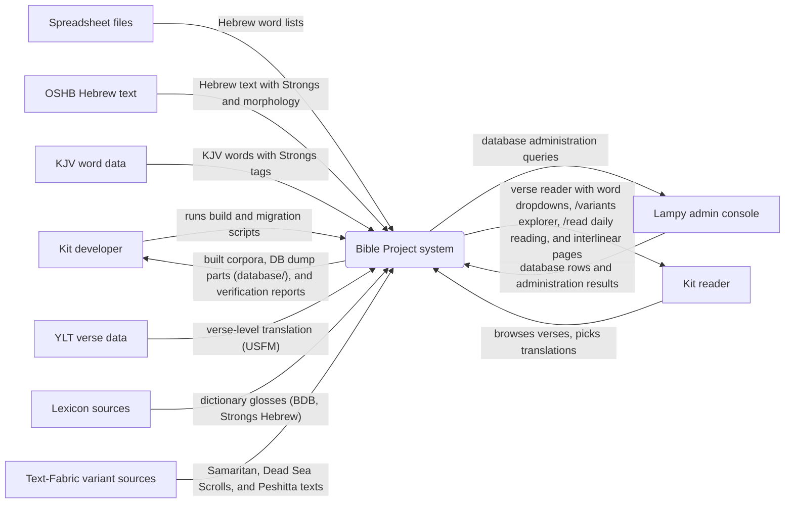

Living document — update these diagrams when adding features.

# bible-project — Architecture

**Relationship to Bible:** this repo is the current, live Bible Project. `cosbykit-afk/Bible` is an earlier partial copy of the same project — its own repo description says so ("Earlier partial Bible-database copy; current work continues in the bible-project repository"). Do not treat them as two independent systems: bible-project is the continuation with the U-8 maqqef-component repair, the U-9 verse-remap repair, YLT word alignment, the Flask translation website, and the v2 normalization, none of which exist in the older Bible repo.

**v2 status (2026-09-28):** the corpus has been normalized to the v2 schema (`schema_v2.sql`, design rationale in `schema_v2.md`). `bible_v2.db` is built and verified, and the live website now serves it via `app_v2.py` — **live cutover DONE 2026-09-28 ~17:15 PDT** on Kit's authorization ("go live with it both on github and on the laptop"; schema approved by Kit: "the schema looks great"). The diagrams below describe v2, which is now the production schema.

**2026-10-24 changes (this revision):** the website migrated from SQLite to PostgreSQL (Kit 2026-10-09) — corpus reads come from the PostgreSQL `bible` database and application data lives in the PostgreSQL `bible_app` database (`website/app_v2.py`, psycopg2), so both can be administered via the Lampy admin tool; per-word choices were normalized into the `word_choice` table (2026-10-09), replacing the `translation_<id>.choices` byte files; a `reading_position` table and the two-doors redesign added `/read` daily reading, `/books`, `/api/books|chapters|verses`, and `/interlinear` routes; the variants campaign (Oct 14–17) added Kethiv/Qere (`build_variants_kq.py`, witness `MT`), Samaritan Pentateuch (`build_variants_sp.py`, witness `SP`), and Dead Sea Scrolls (`build_variants_dss.py`, per-scroll sigla, fully attested verses only) rows to `word_variants`, plus the new verse-scale tables `witness_verses` and `verse_notes` from the Syriac (Peshitta) leg (`build_notes_syr.py`); `export_sync.py` syncs the textual `word_variants` rows and both verse-scale tables from the SQLite build file `bible_v2.db` to the website's PostgreSQL `bible` database; final-form-only readings are marked `orthographic` (Kit 2026-10-17); and the YLT bridge was re-run on v2 and accepted at the 0.7923 precision baseline (Kit 2026-10-17). This revision also restores the website-login content (`user_accounts`, `lemma_default`, `translation.owner_id`) whose 2026-10-10 docs commit (79f68214) was lost when the 2026-10-18 merge (18ef982a) took the local master lineage as precedence — the code for it is present in `app_v2.py` at HEAD.

**2026-09-30 changes (previous revision):** `word_variants` merged into one table tagged by `variant_kind` (`'spelling'` | `'textual'`, CHECK-enforced — Kit's decision); new `word_notes` table (one-to-many word notes, Kit 2026-09-29); `/variants` explorer route added to `app_v2.py`; `database/` now carries a 4-part pg_dump of the live `bible_v2.db`; the 129 OSHB anomaly resolutions applied to `bible_v2`. The level-1 DFD below was also corrected: the previous revision still showed the website reading the v1 `bible.db` live, which the 9/28 cutover superseded — the live site reads `bible_v2.db` via `app_v2.py`.

## 1. Context diagram (level 0)



## 2. Level-1 data flow diagram

```mermaid
flowchart LR
    E1["Kit developer"]
    E2["Kit reader"]
    E3["Source text providers"]
    E8["Text-Fabric variant sources"]
    P1("1.0 Ingest canonical word list")
    P2("2.0 Crosswalk words to OSHB")
    P3("3.0 Load renderings and glosses")
    P4("4.0 Build root tiers and lexicon")
    P5("5.0 Align YLT words and run repairs")
    P6("6.0 Assemble v1 SQLite corpus")
    P7("7.0 Normalize to v2 schema")
    P8("8.0 Serve translation website")
    P9("9.0 Load variant traditions")
    P10("10.0 Sync variants to website database")
    D1[("D1 staged input files")]
    D2[("D2 bible.db - v1 corpus")]
    D3[("D3 bible_v2.db - normalized build corpus")]
    D4[("D4 bible_app - PostgreSQL website data")]
    D6[("D6 database/ DB dump parts")]
    D7[("D7 bible - PostgreSQL corpus")]
    E1 -->|"runs scripts"| P1
    E3 -->|"spreadsheets, OSHB, KJV, YLT, lexicons"| P1
    P1 -->|"canonical words"| D1
    D1 -->|"canonical words"| P2
    D1 -->|"parsed source data"| P3
    P2 -->|"aligned words"| P6
    P3 -->|"renderings, glosses, verses"| P6
    D1 -->|"base words"| P4
    P4 -->|"root tiers, lexicon rows"| P6
    D1 -->|"KJV and YLT tokens"| P5
    P5 -->|"word alignments, repair fixes"| P6
    P6 -->|"v1 corpus"| D2
    P6 -->|"assembly reports"| E1
    D2 -->|"v1 tables"| P7
    P7 -->|"normalized corpus"| D3
    P7 -->|"migration verification report"| E1
    D3 -->|"derived tables (alignment, variants)"| P7
    D3 -->|"pg_dump snapshot published in repo (4 parts)"| D6
    D6 -->|"distributable corpus snapshot"| E1
    E8 -->|"Samaritan, DSS, and Peshitta extraction files"| P9
    D3 -->|"MT corpus words and verses"| P9
    P9 -->|"textual word_variants rows"| D3
    P9 -->|"witness_verses and verse_notes rows"| D3
    D3 -->|"textual variants and verse-scale rows as CSV"| P10
    P10 -->|"synced variant and witness rows"| D7
    E2 -->|"HTTP requests"| P8
    P8 -->|"reads corpus and variants"| D7
    P8 -->|"reads and writes user, translation, choice, and reading-position data"| D4
    P8 -->|"reader pages, /variants explorer, /read pages, and interlinear pages"| E2
```



Process grounding: 1.0 `ingest_canonical.py`; 4.0 `build_roots*.py` + `build_lexicon.py`; 5.0 `build_ylt_align.py`, `repair_u8_maqqef_kjv.py`, `repair_u8_lexicon.py`, `repair_u9_verse_remap_kjv.py`, `repair_u9_lexicon.py`; 6.0 `assemble_bible.py`; 7.0 `migrate_v2.py`, then the derived-data stage `build_alignment.py`, `build_variants.py`, `apply_morph_corrections.py`, the post-normalization fixes `apply_anomaly_resolutions.py` (129 OSHB-verified fixes, 2026-09-29) and `migrate_variants_merge.py` (word_variants variant_kind merge, 2026-09-30); 8.0 `website/app_v2.py` — the LIVE server since the 2026-09-28 ~17:15 PDT cutover, and since 2026-10-09 a PostgreSQL server: corpus reads from PostgreSQL database `bible` (default `BIBLE_DB=bible`), application data in PostgreSQL database `bible_app` (default `APP_DB=bible_app`), both via psycopg2 (`PG_HOST` default `/tmp`, `PG_USER` default `postgres`); supervisord `bible`, port 5057, Apache `/bible`→5057. 9.0 `build_variants_kq.py` (Kethiv/Qere, OSHB morphhb WLC), `extract_sp.py` + `build_variants_sp.py` (Samaritan, DT-UCPH/sp Text-Fabric), `extract_dss.py` + `build_variants_dss.py` (Dead Sea Scrolls, ETCBC/dss Text-Fabric, fully attested verses only), `extract_syr.py` + `build_notes_syr.py` (Syriac Peshitta, ETCBC/peshitta Text-Fabric, verse scale only) — all builders write the SQLite build file `bible_v2.db`. 10.0 `export_sync.py` (CSV in PG COPY format from `bible_v2.db` to the PostgreSQL `bible` database). `website/app.py` (the v1 server) is retained in the repo but superseded; the pre-cutover `/bible-v2` staging copy on port 5058 was observed 2026-09-28 — its post-cutover role was not re-verified. Routes: `/signup`, `/login`, `/logout`, `/` (two-doors Study/Read landing), `/books`, `/book`, `/chapter`, `/verse`, `/word`, `/choice`, `/translations`, `/reading`, `/read` (daily reading with per-user position), `/export`, `/variants`, `/interlinear`, `/api/books`, `/api/chapters`, `/api/verses`, `/papyrus-tile.png`.

## 3. Entity–relationship diagram (v2 schema)

```mermaid
erDiagram
    BOOKS {
        int book_id PK
        string name_en
        string name_he
    }
    VERSES {
        int verse_id PK
        int book_id FK
        int chapter
        int verse
    }
    WORDS {
        int word_id PK
        string orig_word_id
        int verse_id FK
        int word_pos
        string pointed
        string unpointed
        string letters
        string strongs FK
        int strongs_source_id FK
        int morph_pattern_id FK
        int is_aramaic
        int root_id FK
        int root_form_seq FK
        int root_vowel_seq FK
    }
    STRONGS {
        string strongs PK
        string language
    }
    STRONGS_COMPONENTS {
        string strongs FK
        int seq
        string component
    }
    STRONGS_SOURCES {
        int source_id PK
        string source
    }
    MORPH_PATTERNS {
        int pattern_id PK
        string pattern
        string language
        string parse_status
        string parse_notes
    }
    MORPH_SEGMENTS {
        int segment_id PK
        int pattern_id FK
        int seq
        string code
        string pos
        string stem
        string person
        string gender
        string number
        string state
    }
    ROOT_ENTRY {
        int root_id PK
        string root
        int word_count
    }
    ROOT_FORM {
        int root_id FK
        int form_seq
        string prefix1
        string suffix1
        int word_count
        string example_pointed
    }
    ROOT_VOWEL {
        int root_id FK
        int root_form_seq FK
        int vowel_seq
        string vowel_pattern
        int word_count
    }
    LEXICON {
        int root_id FK
        int root_form_seq FK
        int vowel_seq FK
    }
    LEXICON_KJV_RENDERING {
        int root_id FK
        int root_form_seq FK
        int vowel_seq FK
        int seq
        string rendering
    }
    LEXICON_YLT_RENDERING {
        int root_id FK
        int root_form_seq FK
        int vowel_seq FK
        int seq
        string rendering
    }
    LEXICON_YLT_CONTEXT {
        int root_id FK
        int root_form_seq FK
        int vowel_seq FK
        int seq
        int verse_id FK
        string context_text
    }
    LEXICON_FOUND_VERSE {
        int root_id FK
        int root_form_seq FK
        int vowel_seq FK
        int verse_id FK
    }
    GLOSSES {
        string strongs FK
        string source
        string gloss
    }
    KJV_WORDS {
        int kjv_word_id PK
        int verse_id FK
        int kjv_pos
        string kjv_word
        string strongs FK
    }
    KJV_RENDERINGS {
        int rendering_id PK
        int word_id FK
        string kjv_word
        string kjv_strongs FK
        string method
    }
    YLT_VERSES {
        int verse_id PK_FK
        string text
    }
    YLT_RENDERINGS {
        int rendering_id PK
        int word_id FK
        string ylt_word
        int ylt_word_pos
        string label
    }
    WORD_ALIGNMENT {
        int alignment_id PK
        int verse_id FK
        int seq
        int hebrew_word_id FK
        int kjv_word_id FK
        int ylt_rendering_id FK
        string syntactic_role
        string role_basis
    }
    WORD_VARIANTS {
        int word_id FK
        int variant_seq
        string variant_kind
        string unpointed
        string letters
        string variant_text
        string convention
        string source
        string witness
        string variant_type
        string basis
        string created_at
    }
    WORD_NOTES {
        int note_id PK
        int word_id FK
        string note_text
        string note_type
        string source
        string created_at
    }
    MORPH_VARIANTS {
        int word_id FK
        int variant_seq
        string morph_code
        int pattern_id FK
        string confidence
        string source
        string basis
    }
    USER_ACCOUNTS {
        int user_id PK
        string username UK
        string password_hash
        string email
        string display_name
        int is_active
        string created_at
        string last_login_at
    }
    LEMMA_DEFAULT {
        int translation_id FK
        string lemma PK
        string rendering
        int from_word_id
        int source
        int other_option_id
    }
    WORD_CHOICE {
        int translation_id FK
        int word_id FK
        int choice
    }
    READING_POSITION {
        int user_id PK_FK
        int book_id FK
        int chapter
        int translation_id FK
        string updated
    }
    WITNESS_VERSES {
        int verse_id FK
        string witness
        int words
        string text_syr
        string text_translit
    }
    VERSE_NOTES {
        int verse_id FK
        string witness
        string note_kind
        string note_text
        string basis
        string created_at
    }
    APP_USER {
        int user_id PK
        string name
        string created_at
    }
    TRANSLATION {
        int translation_id PK
        int user_id FK
        int owner_id FK
        string name
        string description
        string created_at
        string updated_at
    }
    OTHER_OPTION {
        int option_id PK
        int translation_id FK
        int idx
        string text
        string created_at
    }
    BOOKS ||--o{ VERSES : contains
    VERSES ||--o{ WORDS : contains
    VERSES ||--o{ KJV_WORDS : contains
    VERSES ||--|| YLT_VERSES : has_text
    VERSES ||--o{ WORD_ALIGNMENT : aligns
    WORDS }o--|o STRONGS : tagged_with
    WORDS }o--|o STRONGS_SOURCES : source_recorded_in
    WORDS }o--|o MORPH_PATTERNS : parsed_as
    STRONGS ||--o{ STRONGS_COMPONENTS : decomposes_to
    STRONGS ||--o{ GLOSSES : glossed_by
    MORPH_PATTERNS ||--o{ MORPH_SEGMENTS : splits_into
    ROOT_ENTRY ||--o{ ROOT_FORM : has
    ROOT_FORM ||--o{ ROOT_VOWEL : has
    ROOT_VOWEL ||--|| LEXICON : describes
    WORDS }o--|| ROOT_VOWEL : numbered_as
    LEXICON ||--o{ LEXICON_KJV_RENDERING : lists
    LEXICON ||--o{ LEXICON_YLT_RENDERING : lists
    LEXICON ||--o{ LEXICON_YLT_CONTEXT : cites
    LEXICON ||--o{ LEXICON_FOUND_VERSE : found_in
    LEXICON_YLT_CONTEXT }o--|| VERSES : quotes
    LEXICON_FOUND_VERSE }o--|| VERSES : locates
    KJV_WORDS }o--|o STRONGS : tagged_with
    WORDS ||--o{ KJV_RENDERINGS : rendered_as
    KJV_RENDERINGS }o--|o STRONGS : via_kjv_strongs
    WORDS ||--o{ YLT_RENDERINGS : rendered_as
    WORD_ALIGNMENT }o--|o WORDS : hebrew_side
    WORD_ALIGNMENT }o--|o KJV_WORDS : kjv_side
    WORD_ALIGNMENT }o--|o YLT_RENDERINGS : ylt_side
    WORDS ||--o{ WORD_VARIANTS : varies_as
    WORDS ||--o{ WORD_NOTES : noted_in
    WORDS ||--o{ MORPH_VARIANTS : morph_readings
    MORPH_VARIANTS }o--|o MORPH_PATTERNS : staged_as
    APP_USER ||--o{ TRANSLATION : owns
    USER_ACCOUNTS o|--o{ TRANSLATION : owns_as_owner
    TRANSLATION ||--o{ OTHER_OPTION : adds
    TRANSLATION ||--o{ WORD_CHOICE : selects
    WORD_CHOICE }o--|| WORDS : chooses_for
    TRANSLATION ||--o{ LEMMA_DEFAULT : defaults
    USER_ACCOUNTS ||--|| READING_POSITION : reads_at
    VERSES ||--o{ WITNESS_VERSES : witnessed_by
    VERSES ||--o{ VERSE_NOTES : noted_in
    TRANSLATION }o--o{ WORDS : targets
```

Notes on the ERD: composite primary keys (`ROOT_FORM`, `ROOT_VOWEL`, `LEXICON` and its children, `GLOSSES`, `WORD_VARIANTS`, `MORPH_VARIANTS`, `STRONGS_COMPONENTS`, `WORD_CHOICE` (translation_id, word_id), `LEMMA_DEFAULT` (translation_id, lemma), `WITNESS_VERSES`, `VERSE_NOTES`) are declared in `schema_v2.sql` or in the `app_v2.py` migration DDL quoted in the Grounding notes; the `PK`/`FK` marks above show membership, not single-column keys. `YLT_VERSES.verse_id` is both PK and FK to `VERSES`. `WORD_CHOICE.choice` is CHECK-constrained 1–255 and sparse: an absent row means choice 0 (2026-10-09, replacing the byte files). The `TRANSLATION }o--o{ WORDS : targets` link is logical, not a declared FK — since 2026-10-09 the corpus lives in the PostgreSQL `bible` database and website data in the PostgreSQL `bible_app` database; the SQLite file `bible_v2.db` remains the build corpus the variant builders write, synced to PostgreSQL by `export_sync.py`.

## Grounding notes

- OBSERVED (`schema_v2.sql`, 24 tables): exact table/column names, PKs, FKs, UNIQUE and CHECK constraints quoted above; `words.strongs` nullable (6,008 words), `words.morph_pattern_id` nullable (79 words), `words.strongs_source_id` null iff strongs null (CHECK).
- OBSERVED (migration verification, 2026-09-28): `migrate_v2.py` completed in 66.9 s over 264,217 words; `v_words` 0 differing rows; 0 FK violations; lexicon round-trips 0 mismatches on 126,869 rows; `orig_word_id` not unique (51399, 252785, 227963 each map to 2 rows — split/merged tokens), so no UNIQUE constraint.
- OBSERVED: 1,865 composite Strong's values decomposed into 3,783 `strongs_components` rows (reconstruction assertion 1,865/1,865); 155 components (e.g. `H010`) have no row of their own, so components are NOT a hard FK to `strongs`.
- OBSERVED: `verses` = UNION of (book,chapter,verse) from words, ylt_verses, kjv_words — the 139 English-versification orphans (e.g. Genesis 31:55) resolve; 209 word-derived verses lack YLT.
- OBSERVED: 7,552 `morph_patterns`; `parse_status` parsed/unparsed per the OSHB Hebrew Morphology Codes document (openscriptures.github.io/morphhb/parsing/HebrewMorphologyCodes.html, fetched 2026-09-28, CC BY 4.0); `morph_variants` holds 28 staged readings over 12 words (confidence legacy/established/probable/secondary), never assigned to `words` until adjudicated.
- OBSERVED (`schema_v2.sql` diff, 2026-09-30): `word_variants` MERGED per Kit's decision — ONE table tagged by `variant_kind` CHECK (`'spelling'` | `'textual'`), gaining `variant_text`, `witness`, `variant_type`, `created_at`; `convention`/`source` now nullable (used only for spelling rows). Column discipline per `variants_method.md`: spelling rows use `unpointed`/`letters` + `convention` (`v1-medial` | `academic-final`) + `source` (`v1-stored` | `oshb-verbatim` | `transduced-from-v1` | `conjectural`); textual rows use `variant_text` (pointed reading) + `witness` (manuscript siglum: `LXX`, `DSS`, `SP`, …) + `variant_type` (`orthographic` | `substantive` | …). `variant_seq` continues per word across kinds (spelling rows first, textual appended).
- OBSERVED (`migrate_variants_merge.py`, 2026-09-30): upgraded existing databases in place — all 528,565 rows backfilled `'spelling'`, old-column values verified byte-identical via EXCEPT both ways, 0 FK violations. No textual rows populated yet; the textual apparatus is populated separately.
- OBSERVED (`schema_var_notes.sql`, 2026-09-29): defines the `word_notes` table (note_id PK, word_id FK, note_text, note_type, source, created_at) — one word, many notes, per Kit ("definitely a one to many relationship"); resolves U-4. The file's earlier standalone `word_variants` definition is marked superseded (kept as the column-origin record for the textual kind); the merged table in `schema_v2.sql` is authoritative.
- OBSERVED (`apply_anomaly_resolutions.py`, 2026-09-29): applies 129 OSHB-verified unpointed/letters fixes to `bible_v2`.
- OBSERVED (`website/app_v2.py` diff, commit 3635422d, 2026-09-30): new `/variants` explorer route serving variant readings; routes are now book/chapter/verse/word/choice/translations/reading/export plus `/variants`.
- OBSERVED (`database/bible_dump.sql.gz.part-aa`…`.part-ad`, merged 2026-09-30): pg_dump of the live `bible_v2.db`, 4 parts, published in the repo as a distributable corpus snapshot (commit 02032780).
- OBSERVED (`website/schema.sql`): `app_user`, `translation`, `other_option` verbatim; `website/app.py` (Flask) opens `bible.db` read-only, `app.db` read-write, `user_data/translation_<id>.choices` byte files.
- OBSERVED: **live cutover DONE 2026-09-28 ~17:15 PDT** on Kit's authorization ("go live with it both on github and on the laptop"): supervisord `bible` runs `app_v2.py` on 5057 with `BIBLE_DB=/opt/bible/bible_v2.db`; Apache `/bible`→5057 unchanged; `/bible` + direct 5057 verified 200; word/book/verse pages 200. The 2026-09-30 laptop re-ship (anomaly-corrected `bible_v2.db`) was verified live. The previous diagram revision still showed the website reading the v1 `bible.db` live — that contradiction is corrected in this revision (8.0 reads D3 only; D2 remains the migration input).
- OBSERVED (Kit 2026-10-01, implemented by 2026-10-10): the website's variant readings are the academic (textual) variants, not his manuscript variance — `export_sync.py` exports only `variant_kind='textual'` rows for the website sync.
- OBSERVED (`website/app_v2.py` at HEAD 18ef982a, 2026-10-18): PostgreSQL port — `import psycopg2`, `BIBLE_DB` default `bible`, `APP_DB` default `bible_app`, corpus connection documented "Read-only corpus database (PostgreSQL `bible`)" and app connection "Application database (PostgreSQL `bible_app`): user accounts, translations, lemma defaults, reading positions"; header comment: "the website now reads from PG instead of SQLite so it can be administered via the Lampy admin tool (Kit 2026-10-09)".
- OBSERVED (`website/app_v2.py` migration DDL): `user_accounts(user_id SERIAL PK, username UNIQUE, password_hash, email, display_name, is_active, created_at, last_login_at)` with werkzeug password hashes and Flask session logins (`/signup`, `/login`, `/logout`); `lemma_default(translation_id, lemma, rendering, from_word_id, PRIMARY KEY(translation_id, lemma))` plus `source` (1=KJV, 2=Young's, 3=user-defined) and `other_option_id` columns; `translation.owner_id REFERENCES user_accounts(user_id) ON DELETE SET NULL` (NULL = legacy/anonymous); `word_choice(translation_id, word_id, choice SMALLINT CHECK 1–255, PRIMARY KEY(translation_id, word_id))` — "normalized per-word translation choices; replaces the translation_<id>.choices flat files; sparse: only non-default choices are rows" (2026-10-09); `reading_position(user_id PK, book_id, chapter, translation_id, updated)` for the Read door (2026-10-08).
- OBSERVED (`website/app_v2.py` routes at HEAD): two-doors landing at `/` (Study door and Read door), `/books`, `/read` + `/read/<book>/<chapter>` with translation picker, prev/next, and per-user reading position, `/interlinear`, `/api/books`, `/api/chapters/<n>`, `/api/verses/<n>/<c>`, `/papyrus-tile.png`, in addition to the pre-existing book/chapter/verse/word/choice/translations/reading/export/variants routes.
- OBSERVED (`build_variants_kq.py`): Kethiv/Qere rows — `variant_kind='textual'`, `witness='MT'`, `variant_type='qere'`, from the OSHB morphhb WLC apparatus staged at `sources/morphhb/wlc`; the 2026-10-15 skeleton-search fallback recovered 91 previously skipped pairs.
- OBSERVED (`build_variants_sp.py`): Samaritan Pentateuch rows (`witness='SP'`), source DT-UCPH/sp Text-Fabric 7.2.4 (Schorch editio maior, CC BY-NC 4.0, staged at `sources/sp`), Torah only, per-verse folded-skeleton alignment against MT; matres-only differences are `orthographic`, others `substantive`; final-form-only differences are marked `orthographic` with the FF_SUFFIX basis flag (Kit 2026-10-17).
- OBSERVED (`build_variants_dss.py`): Dead Sea Scrolls rows (`witness` = the scroll's siglum, e.g. `1Qisaa`), source ETCBC/dss Text-Fabric 2.0.1 (Abegg transcriptions, CC BY-NC 4.0, staged at `sources/dss`), fully attested verses only, reusing the Samaritan alignment engine and the same final-form marking.
- OBSERVED (`build_notes_syr.py`): Syriac leg is verse-scale only — creates `witness_verses` (Syriac text per verse) and `verse_notes` (`no_counterpart` and `length_divergence` measured notes, witness `Syr`), source ETCBC/peshitta Text-Fabric v0.5 (Leiden Peshitta main text, CC BY-NC 4.0); it deliberately creates NO word-level Syriac rows. `website/app_v2.py` reads both tables for the verse-scale block (`verse_witness_rows`, `verse_note_rows`), tolerating their absence.
- OBSERVED (`export_sync.py`): exports `word_variants` textual rows, `witness_verses`, and `verse_notes` from the local SQLite `bible_v2.db` to `worker-out/sync/*.csv` in PG COPY format "for the sync to the website's PostgreSQL `bible` DB (Kit 2026-10-17: add and sync with website, both word and verse scale variations)".
- OBSERVED (`build_ylt_align.py` diff and commits df162a5e / 7f5dfe4c, 2026-10-17/18): the YLT bridge was ported to v2 and re-run; Kit accepted the 0.7923 precision v2 baseline and the bridge was applied. This is a data refresh, not a schema change.
- OBSERVED: v1 row counts from README — words 264,217; kjv_words 610,324; kjv_renderings 631,950; ylt_renderings 337,601; ylt_verses 23,145; glosses 17,347; books 39; root_entry 30,087; root_form 57,724; root_vowel 126,869; lexicon 126,869.
- OBSERVED: `worker-out/` subdirectories (canon, kjv, lexicons, oshb, ylt) — the basis for D1; repair scripts named in 5.0; U-8 maqqef-component and U-9 verse-remap repairs with before/after coverage figures in README.
- INFERRED: the numbered process boundaries 1.0–8.0 group scripts by their documented purpose; the repo documents each script's role but no explicit pipeline wiring, so boundaries are inferred.
- INFERRED: `KJV_RENDERINGS.method` values 'direct' | 'maqqef-component' | 'verse-remap' and `YLT_RENDERINGS.label` = 'bridged' are observed in schema comments as the design's vocabulary.
